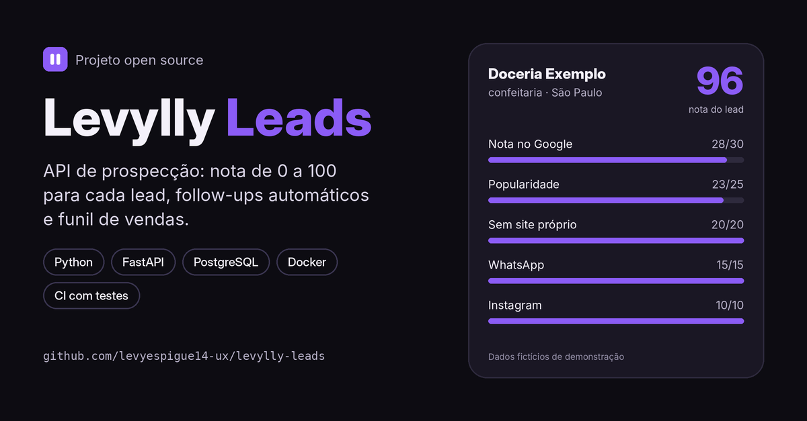

# Levylly Leads



API de prospecção para quem vende sites e sistemas para negócios locais. Ela **dá uma nota de 0 a 100 para cada lead**, mostra **quem abordar primeiro**, controla os **follow-ups** e mede o **funil de vendas**, incluindo as objeções que mais travam o fechamento.

> *A prospecting API for studios that sell websites to local businesses: lead scoring, a small CRM with follow-ups, and a sales funnel with the most common objections.*

[](https://github.com/levyespigue14-ux/levylly-leads/actions)
   

## Por que eu criei

Na [Levylly Studio](https://levylly.netlify.app) eu prospecto confeitarias, açaiterias e restaurantes pelo WhatsApp. Depois de centenas de abordagens, percebi que mandar mais mensagens não resolvia: eu precisava saber **quem abordar primeiro** e **em que etapa os clientes estavam parando** ("já tenho iFood", "vou conversar com o sócio"...). Este projeto transforma isso em dados.

## O que ela faz

- **Nota automática do lead (0–100)**, explicada critério por critério:

  | Critério | Pontos | Lógica |
  |---|---|---|
  | Nota no Google | até 30 | de 3,5 (0 ponto) a 5,0 (30 pontos) |
  | Popularidade | até 25 | nº de avaliações em escala logarítmica (500+ = máximo) |
  | Sem site próprio | 20 | Instagram, iFood, Linktree e afins **não** contam como site |
  | WhatsApp | 15 | só celular (telefone fixo não recebe WhatsApp) |
  | Instagram | 10 | tem perfil para contato |

- **Fila do dia:** os melhores leads novos, filtrados por nicho e cidade.
- **CRM com etapas:** `novo → abordado → followup → respondeu / socio → interessado → proposta → fechado` (ou `perdido`, com o motivo).
- **Follow-ups automáticos:** 1º follow-up 3 dias após a abordagem, 2º 2 dias depois, e para de insistir. Quem diz "vou falar com o sócio" ganha um fluxo próprio. Nunca agenda para domingo.
- **Funil e objeções:** taxa de resposta, taxa de fechamento e o ranking das objeções.
- **Importação de planilha CSV** (separador `;` ou `,`), ignorando telefones repetidos.

## Como rodar

### Com Docker (API + PostgreSQL)

```bash
docker compose up --build
```

A documentação interativa abre em **http://localhost:8000/docs**.

### Sem Docker (SQLite, para testar rápido)

```bash
python -m venv .venv
source .venv/bin/activate        # Windows: .venv\Scripts\activate
pip install -r requirements-dev.txt
uvicorn app.main:app --reload
```

### Testes

```bash
pytest -q                                              # SQLite em memória
TEST_DATABASE_URL=postgresql+psycopg2://... pytest -q  # PostgreSQL
```

O GitHub Actions roda os testes nos dois bancos a cada push.

## Exemplo de uso

```bash
# importa a planilha de exemplo (dados fictícios)
curl -F "arquivo=@data/exemplo_leads.csv" localhost:8000/importar/csv

# quem abordar hoje
curl "localhost:8000/leads/proximos?nicho=confeitaria&limite=25"

# registra que a mensagem foi enviada (agenda o follow-up)
curl -X POST localhost:8000/leads/1/abordagem

# o cliente disse que vai falar com o sócio
curl -X POST localhost:8000/leads/1/status \
  -H "content-type: application/json" \
  -d '{"status": "socio", "motivo": "vai falar com o sócio"}'

# como está o funil e o que mais trava
curl localhost:8000/funil
curl localhost:8000/funil/objecoes
```

Resposta do `/leads/1/nota`:

```json
{"lead_id": 1, "nota": 96,
 "detalhes": {"avaliacao": 28, "popularidade": 23, "sem_site": 20, "whatsapp": 15, "instagram": 10}}
```

## Endpoints

| Método | Rota | Para quê |
|---|---|---|
| `POST` | `/leads` | Cadastra um lead (calcula a nota) |
| `GET` | `/leads` | Lista com filtros (nicho, cidade, status, nota mínima) |
| `GET` | `/leads/proximos` | Melhores leads novos para abordar |
| `GET/PATCH/DELETE` | `/leads/{id}` | Ver, editar (recalcula a nota) e apagar |
| `GET` | `/leads/{id}/nota` | Explica a nota |
| `GET` | `/leads/{id}/historico` | Interações com o lead |
| `POST` | `/leads/{id}/abordagem` | Registra a 1ª mensagem |
| `POST` | `/leads/{id}/followup` | Registra um follow-up |
| `POST` | `/leads/{id}/status` | Muda a etapa e guarda a objeção |
| `GET` | `/followups` | Follow-ups vencidos (respeita o limite diário) |
| `GET` | `/funil` | Funil e taxas |
| `GET` | `/funil/objecoes` | Objeções mais comuns |
| `POST` | `/importar/csv` | Importa planilha |

## Estrutura

```
app/
  main.py       rotas da API
  services.py   regras de negócio (follow-ups, funil, importação)
  scoring.py    cálculo da nota
  models.py     tabelas (SQLAlchemy 2)
  schemas.py    validação (Pydantic 2)
tests/          testes de API e da nota (pytest)
data/           planilha de exemplo com dados fictícios
```

## Próximos passos

- [ ] Coleta de leads a partir do Google Places
- [ ] Painel web com o gráfico do funil
- [ ] Autenticação (JWT) e vários usuários
- [ ] Migrações com Alembic
- [ ] Integração com a Marin, minha assistente de voz que faz as abordagens no WhatsApp

## Autor

**João Levy**: desenvolvedor back-end (Python e Java) e fundador da Levylly Studio.
[LinkedIn](https://www.linkedin.com/in/joao-levy-4008521b2) · [GitHub](https://github.com/levyespigue14-ux)

Licença MIT.
